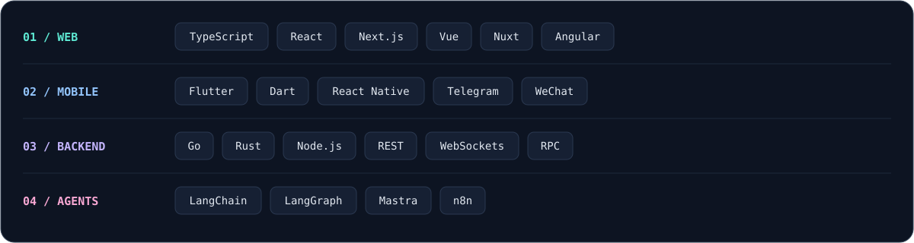

<p align="center">
  <picture>
    
  </picture>
</p>

<p align="center">
  <a href="./README.md" title="Current language: English"></a>
  &nbsp;
  <a href="./README.zh-CN.md" title="切换为简体中文"></a>
</p>

<p align="center">
  <a href="#about">About</a> ·
  <a href="#build">What I Build</a> ·
  <a href="#stack">Tech Stack</a> ·
  <a href="#agents">AI &amp; Automation</a> ·
  <a href="#off-duty">Off Duty</a>
</p>

<p align="center">
  <strong>Full-Stack Developer · Web3 Builder · Professional Debugger 🐛</strong>
</p>

<a name="about"></a>

## 👋 About Me

<details open>
<summary><strong>Meet the developer behind the console</strong></summary>

I build web applications, mobile apps, and mini apps — connecting frontend experiences, backend services, and on-chain data, from interface to infrastructure.

My work spans public blockchain applications, prediction markets, and exchange products. I usually work with TypeScript, Go, Rust, and enough browser tabs to qualify as a distributed system.

- ☕ **I turn coffee into code** and bugs into features (just kidding, I fix them... most of the time).
- 🎨 **I make pixels dance and data flow** — from responsive interfaces to APIs and real-time services.
- ⛓️ **I bring blockchain data into everyday products** — because “just check the transaction hash” is rarely good UX.
- 🧠 **I have a love-hate relationship with JavaScript frameworks** — React is my best frenemy. Next.js made it a group chat.
- 🕵️‍♂️ **I debug like a detective** — following clues across browser consoles, backend logs, and blockchain explorers.

</details>

<a name="build"></a>

## 🚀 What I Build

<details open>
<summary><strong>Explore the products, pipelines, and platforms I build</strong></summary>

| What I build | How I build it |
| :--- | :--- |
| **🌐 Full-Stack Web Applications** | From interface design and frontend interactions to API integration and backend logic. I care about the whole journey — including what happens after someone clicks the button. |
| **📱 Cross-Platform Apps & Mini Apps** | Flutter and React Native apps for iOS and Android, plus Telegram Mini Apps and WeChat Mini Programs. Connecting mobile interfaces to backend services, adapting navigation and interactions to each platform, and making small screens feel less cramped. “It works on my phone” is where testing begins. |
| **⛓️ On-Chain Data & Analytics** | Go services for collecting blocks, transactions, and contract events; indexing data; and analyzing wallet activity, token flows, and DEX trades. Historical backfills, duplicate events, and chain reorgs keep things educational. |
| **📊 Market Data & Trading Systems** | Data pipelines and real-time APIs for prices, trades, candles, order books, and liquidity. Connecting exchange and on-chain feeds to trading screens — with reconnect logic for when the connection has other plans. |
| **🔮 Web3 & Prediction Markets** | Wallet-connected applications, transaction flows, market discovery, live probability updates, positions, and settlement views. Making complex states understandable, one fewer “pending…” at a time. |

</details>

<a name="stack"></a>

## 🧰 My Stack

<picture>
  
</picture>

<details open>
<summary><strong>Inspect the stack · frameworks, services, and platform details</strong></summary>

**Frontend — where people meet the product**

TypeScript · JavaScript · React · **Next.js** · Vue · **Nuxt** · Angular

HTML5 · CSS3 · Sass/SCSS · Vite · Webpack

Responsive layouts, trading interfaces, data visualization, and real-time interactions. And yes, I survived AngularJS.

**Mobile & Mini Apps — more platforms, same attention to detail**

- **Flutter / Dart** — cross-platform iOS and Android apps, reusable widgets, and mobile UI development.
- **React Native / TypeScript** — mobile apps that bring the React ecosystem beyond the browser, with shared application logic and platform-specific interactions.
- **Telegram Mini Apps** — web apps inside Telegram, with host integration, launch flows, and backend connectivity.
- **WeChat Mini Programs** — mini program interfaces, page lifecycles, platform APIs, and backend integration.

Different platforms, different lifecycles. My coffee routine remains compatible with all of them.

**Backend — where the button’s promises get fulfilled**

- **Go** — concurrent services, on-chain data pipelines, event indexing, market data aggregation, and WebSocket APIs.
- **Rust** — performance-sensitive components and blockchain tooling. The compiler asks tough questions before production does.
- **Node.js / TypeScript** — API services, backend-for-frontend (BFF) layers, and integrations that connect different parts of the product.

**Data & Integration — keeping everything in sync**

REST APIs · WebSockets · Blockchain RPC · Event processing

Data normalization · Historical backfills · Deduplication · Reconnect recovery

**Tools & Design**

Git · VS Code · Figma — and a little inspiration from Dribbble.

</details>

<a name="agents"></a>

## 🤖 AI Agents & Automation

<details open>
<summary><strong>Explore my agent and automation experiments</strong></summary>

Exploring ways to turn repetitive work into useful, inspectable workflows.

- **LangChain / LangGraph** — tool integrations and stateful, multi-step agent workflows.
- **Mastra** — agents and workflows that fit naturally into a TypeScript stack.
- **n8n** — connecting AI, APIs, and everyday business processes.

Areas I’m exploring include on-chain research, market summaries, event alerts, and engineering automation.

The goal: fewer copy-paste rituals, more time for problems worth solving.

</details>

<a name="off-duty"></a>

## 🎮 Beyond the Terminal

<details open>
<summary><strong>Cats, questionable aim, and production wisdom.</strong></summary>

- 🐱 **My cat is named `const`** — consistently hungry, surprisingly mutable.
- 🎮 **I’m a gamer** — better at tracking down bugs than tracking moving targets.
- 🍕 **Pizza is my favorite dependency** — updates usually arrive with extra cheese.
- 🧩 **I enjoy puzzles** — Rubik’s Cubes come with fewer logs than distributed systems.

### ☕ My Coding Philosophy

```javascript
await understandTheProblem();
await buildSomethingSimple();
await testTheWholeFlow();
await ship();
await watchWhatActuallyHappens();

// Coffee helps. Logs help more.
```

</details>

---

<p align="center"><samp>Interfaces polished. APIs connected. Coffee replenished.</samp></p>
