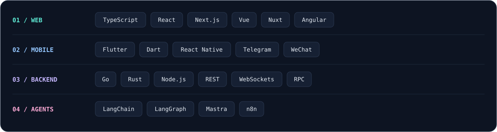

<p align="center">
  <picture>
    
  </picture>
</p>

<p align="center">
  <a href="./README.md" title="Read in English"></a>
  &nbsp;
  <a href="./README.zh-CN.md" title="当前语言：简体中文"></a>
</p>

<p align="center">
  <a href="#about">关于我</a> ·
  <a href="#build">我在构建什么</a> ·
  <a href="#stack">技术栈</a> ·
  <a href="#agents">AI 与自动化</a> ·
  <a href="#off-duty">终端之外</a>
</p>

<p align="center">
  <strong>全栈开发者 · Web3 构建者 · 专业 Debugger 🐛</strong>
</p>

<a name="about"></a>

## 👋 关于我

<details open>
<summary><strong>认识一下控制台背后的开发者</strong></summary>

我开发 Web 应用、移动 App 和小程序，将前端体验、后端服务与链上数据连接起来，工作范围从界面延伸到基础设施。

我的工作涉及公链应用、预测市场和交易所产品。常用 TypeScript、Go、Rust，还有多到足以组成一个分布式系统的浏览器标签页。

- ☕ **把咖啡变成代码**，把 Bug 变成“功能”——开个玩笑，大多数时候我还是会修 Bug 的。
- 🎨 **让界面动起来，让数据流起来**：从响应式页面到 API，再到实时服务。
- ⛓️ **把链上数据带进日常产品**：毕竟“你自己按交易哈希查一下”通常不算好体验。
- 🧠 **和 JavaScript 框架相爱相杀**：React 是我的最佳损友，Next.js 则让这段关系变成了群聊。
- 🕵️‍♂️ **像侦探一样排查问题**：沿着浏览器控制台、后端日志和区块链浏览器寻找线索。

</details>

<a name="build"></a>

## 🚀 我在构建什么

<details open>
<summary><strong>产品、数据管道与平台</strong></summary>

| 我在构建什么 | 如何实现 |
| :--- | :--- |
| **🌐 全栈 Web 应用** | 从界面设计、前端交互到 API 集成和后端逻辑，关注完整用户流程，也关注用户点击按钮之后发生的事。 |
| **📱 跨平台 App 与小程序** | 使用 Flutter、React Native 开发 iOS / Android 应用，以及 Telegram Mini Apps 和微信小程序。连接移动界面与后端服务，适配各平台的导航和交互，让小屏幕也用得顺手。“在我手机上能用”只是测试的开始。 |
| **⛓️ 链上数据与分析** | 用 Go 采集区块、交易和合约事件，建设索引，分析钱包行为、Token 流向与 DEX 交易。历史数据回补、重复事件和链重组，总能让人学到新东西。 |
| **📊 行情数据与交易系统** | 为价格、成交、K 线、订单簿和流动性建设数据管道及实时 API，把交易所与链上数据接入交易界面；也准备了重连逻辑，应对偶尔“不太配合”的网络连接。 |
| **🔮 Web3 与预测市场** | 连接钱包的应用、交易流程、市场浏览与发现、实时概率更新、持仓和结算视图。让复杂状态更容易理解，也让用户少盯一次“处理中……”。 |

</details>

<a name="stack"></a>

## 🧰 技术栈

<picture>
  
</picture>

<details open>
<summary><strong>框架、服务与平台实践</strong></summary>

**前端：用户与产品相遇的地方**

TypeScript · JavaScript · React · **Next.js** · Vue · **Nuxt** · Angular

HTML5 · CSS3 · Sass/SCSS · Vite · Webpack

响应式布局、交易界面、数据可视化和实时交互。没错，我也从 AngularJS 时代走过来了。

**移动端与小程序：平台更多，对细节的关注不变**

- **Flutter / Dart**：iOS / Android 跨平台 App、可复用组件和移动界面开发。
- **React Native / TypeScript**：把 React 生态带到浏览器之外，复用应用逻辑，适配平台交互。
- **Telegram Mini Apps**：运行在 Telegram 内的 Web 应用、宿主平台集成、启动流程与后端连接。
- **微信小程序**：页面与生命周期、平台 API 和后端集成。

不同平台有不同生命周期。我的咖啡习惯倒是全平台兼容。

**后端：兑现按钮承诺的地方**

- **Go**：并发服务、链上数据管道、事件索引、行情聚合和 WebSocket API。
- **Rust**：性能敏感组件和区块链工具。编译器会抢在生产环境之前，先问几个难题。
- **Node.js / TypeScript**：API 服务、面向前端的后端服务（BFF），以及连接产品各部分的集成层。

**数据与集成：让各个环节保持同步**

REST API · WebSocket · 区块链 RPC · 事件处理

数据规范化 · 历史数据回补 · 去重 · 重连恢复

**工具与设计**

Git · VS Code · Figma，以及偶尔从 Dribbble 找到的一点灵感。

</details>

<a name="agents"></a>

## 🤖 AI Agent 与自动化

<details open>
<summary><strong>Agent 与自动化实践探索</strong></summary>

探索如何把重复工作变成有用、可检查的工作流。

- **LangChain / LangGraph**：工具集成，以及有状态、多步骤的 Agent 工作流。
- **Mastra**：融入 TypeScript 技术栈的 Agent 与工作流。
- **n8n**：连接 AI、API 和日常业务流程。

正在探索的方向包括链上研究、市场摘要、事件提醒和研发自动化。

目标很朴素：少一点复制粘贴，多一点时间解决值得解决的问题。

</details>

<a name="off-duty"></a>

## 🎮 终端之外

<details open>
<summary><strong>猫、随缘枪法，以及生产环境教会我的事</strong></summary>

- 🐱 **我的猫叫 `const`**：饿得一如既往，行为却出奇多变。
- 🎮 **喜欢打游戏**：追踪 Bug 比瞄准移动目标更在行。
- 🍕 **最喜欢的依赖是披萨**：每次“更新”通常都多加点芝士。
- 🧩 **喜欢解谜**：至少玩魔方时，要看的日志比分布式系统少多了。

### ☕ 我的编码哲学

```javascript
await understandTheProblem();
await buildSomethingSimple();
await testTheWholeFlow();
await ship();
await watchWhatActuallyHappens();

// 咖啡有帮助，日志更有帮助。
```

</details>

---

<p align="center"><samp>界面打磨好了，API 接上了，咖啡也续上了。</samp></p>
